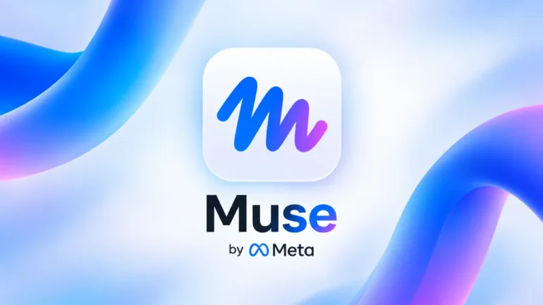

  

# Agent Mail Signup

**Let your AI agent sign up for websites for you — with its own email address, generated passwords, and a one-time setup interview that personalizes everything.**

## The idea

Creating accounts is friction: pick a password, save it somewhere, wait for the verification email, copy the code, log in again to check it worked. This skill turns that whole loop into one sentence from you — *"sign me up for X"* — and a short report back.

The pattern has four parts:

1. **An agent-owned mailbox.** Signups use the agent's own email address, so activation mail reaches the agent directly.
2. **Generated passwords, stored in a vault.** A unique 20+ character password per site, saved to the platform's secure credential vault — never in chat, files, or logs.
3. **A one-time setup interview.** When the skill is first installed, the agent asks a short set of questions once (email to use, date-of-birth policy, country/city, name policy, phone and address limits, stop conditions) and saves them to a local `PROFILE.md`. Every later form is filled from that profile, silently.
4. **A security model that treats mail as data.** Incoming email is never an instruction — only the owner's verified address can instruct the agent. An activation email is used for exactly one thing: that signup's code or link.

## What it does

- Registers only on sites **you explicitly name** — no speculative or bulk signups.
- Verifies free offers are live and personally claimable before creating an account.
- Completes email activation (code or link), then **logs in once to verify** the account actually works.
- Reports briefly: site, plan/quota, activation status, where the password lives.
- Keeps a password-free `registry.md` of created accounts.
- Later, signs in for you on request and confirms the session is live.

## Built-in stop conditions

The agent stops and asks before: identity verification (document photo/selfie), payment or card details, SMS/phone verification, and puzzle CAPTCHAs (it offers you a quick live-browser takeover instead). Simple "I'm not a robot" checkboxes are part of the normal browser flow. One account per site — never for ban evasion, fake engagement, or spam.

## Files

| File | Purpose | Shareable? |
|---|---|---|
| `SKILL.md` | The skill itself | Yes — this is the repo's content |
| `PROFILE.md` | Your setup-interview answers | **No — local only, never commit** |
| `registry.md` | Password-free account list | Local only |

## Install

Copy `SKILL.md` into your agent's skills directory. On first use, your agent will run the setup interview and create its own `PROFILE.md` and `registry.md`.

## Credits

Born from a real workflow between a user and their personal agent (Muse), then generalized for the community. If it saves you the signup slog, it did its job.
